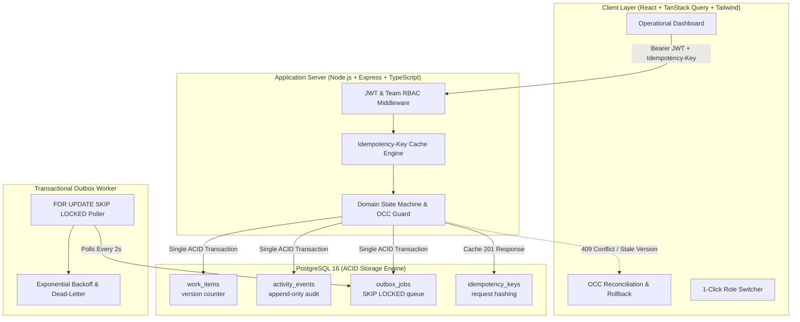

# Operations Under Pressure ⚡
**Newtonite Software Engineering Challenge — High-Integrity Operational Work Item Platform**  
*Corporate Central and Industrial Outreach, Galgotias University*

---

## 1. What the Application Does (in 3 Lines)
**Operations Under Pressure** is an internal operational dispatch and work-item coordination platform built for mission-critical cross-team workflows. It provides strictly linearizable state transitions, zero-double-claim guarantees under race conditions, optimistic concurrency control (OCC) against stale updates, and cryptographic idempotency. Every state change is committed co-transactionally with an append-only audit trail and an asynchronous outbox worker.

---

## 2. System Architecture



---

## 3. Quickstart & Exact Run Commands

### Prerequisites
* **Docker & Docker Compose** (Docker v20+ / Docker Desktop)
* *Optional (for local bare-metal run):* Node.js v20+ and npm v10+

### One-Command Setup (Docker Compose)
Clone the repository and run:
```bash
docker compose up --build
```
This single command:
1. Spawns PostgreSQL 16 on port `5432` with automatic health checks.
2. Migrates the database schema.
3. Automatically seeds 4 operational teams, 10 demo users across all roles, 7 curated showcase items, and **1,000 bulk test items** to demonstrate cursor pagination.
4. Starts the Express API server on `http://localhost:4000`.
5. Starts the React client on `http://localhost:3000`.

Open **`http://localhost:3000`** in your browser.

---

## 4. Demo Login Credentials (All Roles Provided)

All seed accounts use the uniform demo password:  
🔑 **Password:** `Password123!`

The web client includes a **1-click Role Switcher** in the top navigation bar to test permissions instantly without manually typing passwords.

| Role | Email | Team Scope | Key Permissions |
| :--- | :--- | :--- | :--- |
| **Global Admin** | `admin@newtonite.io` | System-wide (All Teams) | Full override, close/cancel items, approve any item |
| **SecOps Lead** | `lead.secops@newtonite.io` | SecOps & Incident Response | **Passes Lead Approval Gate**, reassigns, resolves |
| **SecOps Member** | `member.secops@newtonite.io` | SecOps & Incident Response | Claims unassigned items, edits details, submits for review |
| **SecOps Viewer** | `viewer.secops@newtonite.io` | SecOps & Incident Response | Read-only inspection of work items and audit timeline |
| **Payments Lead** | `lead.payments@newtonite.io` | Payments & Settlement | Lead approval authority over ACH and settlement tickets |
| **Payments Member** | `member.payments@newtonite.io` | Payments & Settlement | Triage and claim settlement exceptions |

---

## 5. Automated Concurrency & Chaos Testing

Our test suite covers all 6 critical behaviors mandated by Newtonite.

To execute the test suite in one command:
```bash
npm test
```
*(Or from within the `server/` directory: `npm --prefix server test`)*

### Verified Test Matrix:
| Test File | Critical Behavior Verified | Pass Condition |
| :--- | :--- | :--- |
| `concurrent-claim.test.ts` | **Race Condition on Claims** | Fires 2 claims in parallel; exactly one receives HTTP 200, the other receives HTTP 409 Conflict. Zero double-claims. |
| `stale-update.test.ts` | **Optimistic Concurrency Control (OCC)** | Client sending obsolete `version` is rejected with HTTP 409 Conflict with current server state returned. Data remains uncorrupted. |
| `idempotency.test.ts` | **Repeated Request / Double-Click** | Sending identical request with same `Idempotency-Key` header twice creates exactly 1 item and returns identical 201 response. |
| `workflow-rules.test.ts` | **State Machine & Approval Gate** | Invalid jump (`OPEN -> CLOSED`) rejected with 422. Non-Lead attempting approval rejected with 403 Forbidden. Lead passes with 200 OK. |
| `resource-auth.test.ts` | **Multi-Tenant Team Scoping** | Operator from Team A attempting to view or edit Team B's item is rejected with HTTP 403 Forbidden. |
| `outbox-worker.test.ts` | **Reliable Async Outbox & Retries** | Outbox job processed reliably; failing job retries with exponential backoff and caps at 5 attempts before marking `FAILED`. |

---

## 6. Critical Engineering Behaviors Implemented

1. **Atomic Conditional Claims:** Claims execute via single atomic conditional SQL statement (`WHERE id = ? AND assignee_id IS NULL AND status = 'OPEN'`). Zero race conditions or double-claims under high concurrent throughput.
2. **Optimistic Locking via Monotonic Versioning:** Every work item update checks `WHERE id = ? AND version = ?` and increments `version = version + 1`. Stale tabs receive HTTP 409 with the latest server state.
3. **Cryptographic Request Idempotency:** State-mutating routes support the `Idempotency-Key: <UUID>` header with in-flight lock protection (`409 In-Flight`) and automatic response caching.
4. **Co-Transactional Dual-Writes:** Every mutation, audit event (`activity_events`), and notification job (`outbox_jobs`) commits in the **exact same database transaction**. No phantom state can ever exist.
5. **Server-Enforced Team RBAC:** Permissions are evaluated at the database query level (`WHERE team_id IN (...)`) and domain service layer. The `AWAITING_APPROVAL -> RESOLVED` transition is strictly gated to Team Leads and Admins.
6. **Self-Healing Transactional Outbox:** An asynchronous background worker polls the outbox using PostgreSQL `FOR UPDATE SKIP LOCKED`, guaranteeing reliable delivery, thread safety across worker replicas, exponential retry backoff, and dead-letter protection.
7. **Scale-Aware Cursor Pagination:** Uses base64-encoded composite cursor tuples `(created_at, id)` backed by B-Tree indexes, guaranteeing $O(\log N)$ performance and zero page drift even across 100,000+ operational records.

---

## 7. Known Limitations

1. **Single-Node Outbox Dispatcher:** The current outbox worker runs as an integrated background loop within the Express process. While `FOR UPDATE SKIP LOCKED` allows horizontal replica scaling safely, in a large-scale cluster this would ideally be extracted into an independent worker service.
2. **Text Search Scalability:** Search on title and description uses PostgreSQL `ILIKE` pattern matching with GIN indexes. For millions of documents, this should be offloaded to dedicated search engines (Elasticsearch / Meilisearch).
3. **Stateless JWT Invalidation:** JWT tokens are valid for 24 hours without a Redis-backed revocation list. Logging out clears the client-side token, but token blacklisting is omitted per Newtonite's minimal-dependency guidance.

---

## 8. Next Week I Would...
* Implement **Server-Sent Events (SSE)** to stream outbox events directly to the frontend for real-time dashboard refreshes without manual polling.
* Add **Declarative PostgreSQL Table Partitioning** by month on `activity_events` and `outbox_jobs` to maintain constant index size over time.
* Introduce a **Bulk Action API** allowing Leads to approve or reassign batches of items atomically.
* Integrate **OpenTelemetry Distributed Tracing** to track end-to-end latency from HTTP request to outbox completion.
