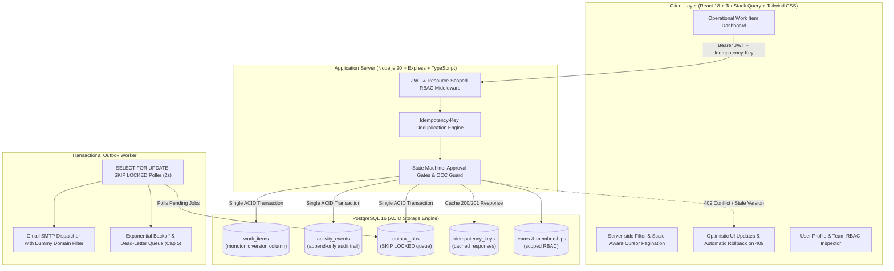

# Operations Under Pressure ⚡
**Newtonite Software Engineering Challenge — High-Integrity Operational Work Item Platform**  
*Galgotias University • Corporate Central and Industrial Outreach (CCIO)*  
**Candidate:** Aryan Duve | **Roll No:** `23131010576` | **Track:** Software Engineering (Full-Stack)  
**Repository:** `newtonite-ops-23131010576`

[](https://github.com/Aryandubey825/newtonite-ops-23131010576)
[](LICENSE)
[](https://newtonite-ops-blue.vercel.app)

---

## 1. What the Application Does (in 3 Lines)
**Operations Under Pressure** is an internal dispatch and coordination platform built for mission-critical, cross-team incident and task management. It guarantees **zero double-claims** under extreme race conditions, **optimistic concurrency control (OCC)** against stale overwrites, and **cryptographic request idempotency** for retried network payloads. Every mutation commits co-transactionally with an append-only audit trail and an asynchronous transactional outbox worker for reliable external dispatch.

🔗 **Live Deployment Preview:** [https://newtonite-ops-blue.vercel.app](https://newtonite-ops-blue.vercel.app)  
📂 **Architecture Decisions & Trade-offs:** [`ENGINEERING_DECISIONS.md`](./ENGINEERING_DECISIONS.md)

---

## 2. System Architecture



---

## 3. Quickstart & Exact Run Commands

### Prerequisites
* **Docker & Docker Compose** (Docker v20+ / Docker Desktop)
* *Optional (for bare-metal execution):* Node.js v20+ and PostgreSQL 16

### One-Command Setup (Docker Compose)
Clone the repository and run:
```bash
docker compose up --build
```

**What this single command executes automatically:**
1. Spawns PostgreSQL 16 on port `5432` with built-in health-checks.
2. Synchronizes the Prisma schema (`prisma db push`).
3. Executes a comprehensive seed script:
   - Creates **4 operational teams** (`SecOps`, `Payments`, `Platform Infra`, `Trust & Compliance`).
   - Seeds **10 demo users** across all role tiers (`ADMIN`, `LEAD`, `MEMBER`, `VIEWER`).
   - Creates **7 curated showcase work items** with rich activity logs and transitions.
   - Seeds **1,000 bulk work items** with indexed timestamps to prove scale-aware cursor pagination.
4. Starts the Node.js Express backend on `http://localhost:4000`.
5. Starts the React 18 client on `http://localhost:3000`.

Open **`http://localhost:3000`** in your browser.

---

## 4. Demo Login Credentials (All Roles & Teams)

All seeded accounts share a uniform demo password:  
🔑 **Password:** `Password123!`

For rapid evaluation, the **Login Screen** features **1-Click Quick Demo Login** buttons for the 4 primary personas. Alternatively, you can type any credential manually:

| Role Tier | Full Name | Email Address | Team Scope | Key Authorities & RBAC Permissions |
| :--- | :--- | :--- | :--- | :--- |
| **Global Admin** | Alex Mercer | `admin@newtonite.io` | **All Teams** (System-wide) | Full override; close/cancel items; approve any item; invite & remove members |
| **SecOps Lead** | Sarah Connor | `lead.secops@newtonite.io` | SecOps & Incident Response | **Passes Lead Approval Gate** (`AWAITING_APPROVAL -> RESOLVED`); reassigns items |
| **SecOps Member** | John Reese | `member.secops@newtonite.io` | SecOps & Incident Response | Claims unassigned items; edits title/description; submits item for Lead approval |
| **SecOps Viewer** | Marcus Wright | `viewer.secops@newtonite.io` | SecOps & Incident Response | Read-only inspection of work items, metrics, and audit timeline (mutations blocked) |
| **Payments Lead** | Rachel Zane | `lead.payments@newtonite.io` | Payments & Settlement | Lead approval authority over financial reconciliations & chargeback exceptions |
| **Payments Member** | Mike Ross | `member.payments@newtonite.io` | Payments & Settlement | Claims and triages failed settlement batches and payment gateway downtimes |
| **Infra Lead** | Gordon Freeman | `lead.infra@newtonite.io` | Platform & Infrastructure | Authorizes database failovers, cloud capacity scaling, and network routing fixes |
| **Infra Member** | Alyx Vance | `member.infra@newtonite.io` | Platform & Infrastructure | Investigates server anomalies and applies cluster hotfixes |
| **Compliance Lead** | Donna Paulsen | `lead.compliance@newtonite.io` | Trust & Compliance | Authorizes regulatory audit filings, SOC2 artifacts, and data retention sign-offs |
| **Compliance Member**| Harvey Specter | `member.compliance@newtonite.io`| Trust & Compliance | Prepares KYC/AML compliance records |

> **Note on Custom Invited Users:** When you invite a new team member (e.g. `yourname@gmail.com`), an invitation link is generated. Upon accepting the invitation and setting a password, that user can sign in with their email and custom chosen password.

---

## 5. Automated Concurrency & Chaos Testing

Our test suite covers all critical operational hazards mandated by Newtonite.

To run the automated tests inside Docker:
```bash
docker compose exec -T server npm test
```

Or locally from the project root:
```bash
npm --prefix server test
```

### Verified Test Matrix (23/23 Passing):
| Test File | Critical Behavior Verified | Pass Condition |
| :--- | :--- | :--- |
| `tests/concurrent-claim.test.ts` | **Concurrent Claim Race Condition** | Fires 2 claims simultaneously; exactly one receives HTTP 200, the other receives HTTP 409 Conflict. Zero double-claims. |
| `tests/stale-update.test.ts` | **Optimistic Concurrency Control (OCC)** | Client submitting an outdated `version` is rejected with HTTP 409 Conflict returning current server state. Data remains uncorrupted. |
| `tests/idempotency.test.ts` | **Repeated Request / Network Retry** | Sending identical request with the same `Idempotency-Key` header twice creates exactly 1 item and returns identical cached response. |
| `tests/workflow-rules.test.ts` | **State Machine & Lead Approval Gate** | Invalid jump (`OPEN -> CLOSED`) rejected with 422. Non-Lead attempting approval rejected with 403 Forbidden. Lead passes with 200 OK. |
| `tests/resource-auth.test.ts` | **Resource-Level Multi-Tenant Scoping** | Operator from Team A attempting to inspect or edit Team B's item is rejected with HTTP 403 Forbidden. |
| `tests/outbox-worker.test.ts` | **Transactional Outbox & Retry Backoff**| Outbox job processed reliably; failing job retries with exponential backoff and caps at 5 attempts before marking `FAILED`. |
| `tests/team-admin.test.ts` | **Team RBAC & Member Invitations** | Only ADMIN can add/remove members; validates role hierarchy, email deduplication, and invitation token generation. |

---

## 6. Critical Engineering Behaviors Beyond CRUD

Newtonite's challenge explicitly tests engineering judgement in handling non-trivial operational hazards:

1. **Atomic Conditional Claims (Zero Double-Claim Guarantee):**
   - Claims execute via an atomic single-statement SQL update:
     ```sql
     UPDATE work_items 
     SET assignee_id = $userId, status = 'IN_PROGRESS', version = version + 1, updated_at = NOW()
     WHERE id = $itemId AND assignee_id IS NULL AND status = 'OPEN';
     ```
   - If 0 rows are updated, the engine immediately yields `409 Conflict` (`"Item is already claimed by another operator"`). This guarantees zero race condition windows without holding pessimistic database table locks.

2. **Optimistic Concurrency Control (OCC) with Monotonic Versions:**
   - Every `WorkItem` maintains an integer `version` incremented on every mutation.
   - Updates enforce `WHERE id = $id AND version = $clientVersion`.
   - Stale client tabs attempting writes receive HTTP `409 Conflict` containing the fresh server record, enabling client-side reconciliation.

3. **Cryptographic Request Idempotency:**
   - Clients send `Idempotency-Key: <UUID>` on all mutating actions.
   - If a duplicate key is in-flight, it returns `409 Conflict (In-Flight)`.
   - Completed keys store the serialized response in `idempotency_keys` with a 24-hour TTL, ensuring network retries or double-clicks produce zero duplicate records.

4. **Co-Transactional Dual-Writes & Audit Integrity:**
   - Work item mutation, `activity_events` audit row, and `outbox_jobs` entry commit in the **exact same ACID database transaction** (`prisma.$transaction`).
   - If any step fails, the entire change rolls back. History can never disagree with current state.

5. **Server-Enforced Team RBAC & Lead Approval Gate:**
   - Permissions are evaluated on the server at query level (`WHERE team_id IN (...)`).
   - State machine enforces allowed transitions:
     - `OPEN` ➔ `IN_PROGRESS` (Any Team Member)
     - `IN_PROGRESS` ➔ `AWAITING_APPROVAL` (Assignee or Team Member)
     - `AWAITING_APPROVAL` ➔ `RESOLVED` (**Strictly gated to Team LEAD or Global ADMIN**)
     - `RESOLVED` ➔ `CLOSED` (LEAD or ADMIN)

6. **Self-Healing Transactional Outbox Worker:**
   - Outbox worker polls `outbox_jobs` using `SELECT FOR UPDATE SKIP LOCKED`, allowing safe multi-replica horizontal scaling without duplicate job execution.
   - Features exponential retry backoff, attempt capping ($max = 5$), dead-letter handling, and real Gmail SMTP dispatch with dummy test domain filtering.

7. **Scale-Aware Cursor Pagination:**
   - High-throughput work-item feeds use base64-encoded composite cursor tuples `(createdAt, id)` backed by composite B-Tree indexes:
     ```sql
     CREATE INDEX idx_work_items_team_created_id ON work_items(team_id, created_at DESC, id DESC);
     ```
   - Guarantees constant $O(\log N)$ retrieval time and zero page drift even under rapid item creation.

---

## 7. Known Limitations

1. **In-Process Outbox Loop:** The current outbox poller runs as a background worker within the Express server process. In a high-throughput production cluster, this would be decoupled into a standalone dedicated worker container or serverless consumer.
2. **Text Search Scalability:** Text search across titles and descriptions uses PostgreSQL `ILIKE` with indexes. At millions of records, full-text search should be offloaded to Elasticsearch or Meilisearch.
3. **Stateless JWT Invalidation:** JWTs expire after 24 hours without a Redis-backed token revocation list. Logging out clears the client-side token, but token blacklisting is omitted to adhere to Newtonite’s minimal-dependency guidance.

---

## 8. Next Week I Would...
* **Server-Sent Events (SSE) / WebSockets:** Push real-time outbox notifications directly to active client dashboards for instant ticket updates.
* **Declarative PostgreSQL Table Partitioning:** Partition `activity_events` and `outbox_jobs` tables by month to preserve high write throughput over time.
* **Bulk Operation APIs:** Allow Team Leads to approve or reassign batches of tickets atomically in a single multi-row transaction.
* **OpenTelemetry Distributed Tracing:** Instrument end-to-end spans from client click to outbox delivery for observability under pressure.

---

## 9. Deliverables & Submission Checklist

- [x] Public GitHub repo with complete commit history showing iterative progression
- [x] Single-command execution: `docker compose up --build`
- [x] Seed data with all 4 operational teams, 10 users across all roles, and 1,000 bulk test items
- [x] Zero committed secrets; `.env.example` provided
- [x] All 23 backend integration tests passing with one command (`npm test`)
- [x] Comprehensive architectural decisions documented in [`ENGINEERING_DECISIONS.md`](./ENGINEERING_DECISIONS.md)
- [x] Production deployment active on Vercel: [https://newtonite-ops-blue.vercel.app](https://newtonite-ops-blue.vercel.app)
