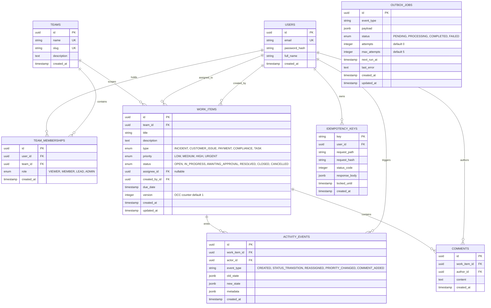
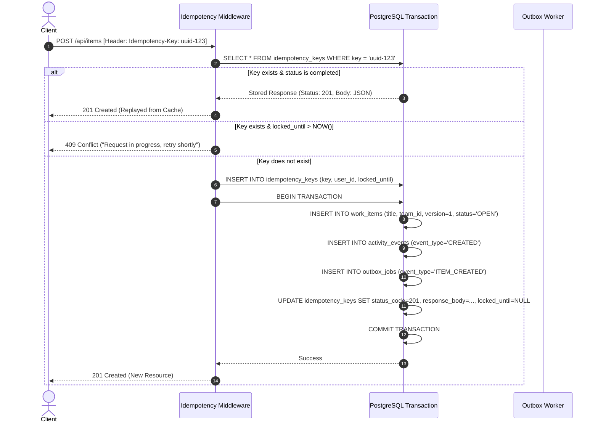
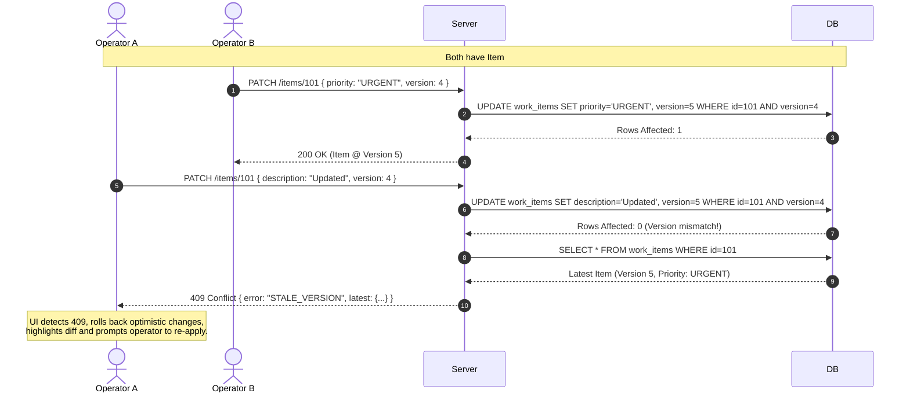
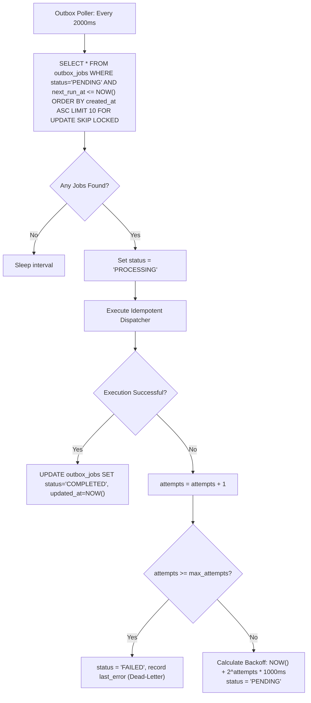

# System Design & Technical Specification: Operations Under Pressure
**Candidate / Engineering Track:** Software Engineering (Full-Stack) — Newtonite Challenge  
**Target System:** High-Integrity Operational Work Item & Workflow Platform  
**Author:** Senior Staff Engineer Specification  
**Status:** Canonical Design & Execution Blueprint

---

## 1. Executive Summary & Design Philosophy

The Newtonite "Operations Under Pressure" platform is an internal mission-critical operational coordination engine. It coordinates cross-team workflows for urgent operational units (Incidents, Customer Escalations, Payment Failures, Compliance Breaches, and Tasks).

### Core Engineering Axioms:
1. **Correctness over Feature Breadth:** A system with 5 screens that silently drops updates, permits double claims, or allows non-leads to bypass approvals is an operational liability. A tightly constrained system that guarantees linearizability, transactional integrity, and idempotency is an operational asset.
2. **The Database is the Source of Truth:** Business rules (state machines, version locks, permissions) are enforced at the database and application service layer, never solely in the browser.
3. **No Phantom State:** Every state mutation, owner handover, or priority escalation is committed in the **exact same database transaction** as its corresponding append-only `activity_event` and `outbox_job`. Discrepancies between current state and historical audit logs are mathematically impossible.
4. **Resilience to Concurrency & Retries:** Every mutative operation is built to tolerate concurrent collisions (via row-level locking or optimistic version checks) and duplicate execution (via cryptographic idempotency keys).

---

## 2. Domain Model & Invariants



### Immutable Invariants:
1. **Tenant/Team Boundary:** An item $I$ belonging to Team $T_1$ can *only* be read or mutated by a user $U$ if $\exists$ `membership` $(U, T_1)$ or $U$ is a Global `ADMIN`.
2. **Version Monotonicity:** For any update on WorkItem $I$, $Version_{new} = Version_{old} + 1$. Updates supplying $Version_{client} \neq Version_{current}$ are rejected with `409 Conflict`.
3. **Atomic Claim Exclusivity:** An item in `OPEN` status can only be claimed if `assignee_id IS NULL`. Exactly one claimant will succeed; all concurrent claimants receive `409 Conflict`.
4. **Approval Authorization Boundary:** Transition from `AWAITING_APPROVAL` to `RESOLVED` requires the actor's role in that item's team to be `LEAD` or `ADMIN`.
5. **Transactional Log Coherence:** Count of state changes on WorkItem $I$ must equal the count of `STATUS_TRANSITION` events in `activity_events` for $I$.

---

## 3. Feature-by-Feature Deep Mechanics & Execution Flows

---

### Feature 1: Authentication & Team-Scoped RBAC Middleware

#### Context & Responsibility:
Authenticates the client via signed JWT bearer tokens and resolves user identities and team-level roles into request context (`req.user`, `req.memberships`).

#### Mechanics:
1. Client submits credentials to `POST /api/auth/login`.
2. Server validates bcrypt hash and issues a signed JWT containing `{ sub: user.id, email: user.email }`.
3. On every protected request, `authMiddleware` verifies the token and attaches `req.user`.
4. For resource-specific routes (e.g. `/api/teams/:teamId/items` or `/api/items/:id`), `requireTeamRole(minRole)` middleware executes:
   - Fetches the item or target team.
   - Evaluates:
     $$\text{RoleWeight}(UserRole) \ge \text{RoleWeight}(RequiredRole)$$
     where $\text{VIEWER} (10) < \text{MEMBER} (20) < \text{LEAD} (30) < \text{ADMIN} (40)$.
   - If unauthorized: Returns `403 Forbidden` (`{"error": "INSUFFICIENT_TEAM_PERMISSIONS"}`).
   - If item belongs to a team the user has no membership in: Returns `404 Not Found` (avoids resource enumeration / privacy leakage) or `403 Forbidden`.

---

### Feature 2: Work Item Creation & Idempotency Guarantee

#### Context & Problem:
Network jitter or impatient user double-clicks can cause duplicate creation of high-priority operational items (e.g., duplicate Incidents).

#### Flow:


#### In-Flight Lock Protection:
If request 1 is still computing in the DB transaction when request 2 arrives with the same key, request 2 detects `locked_until > NOW()` and returns `409 Conflict / In-Flight`, preventing double processing.

---

### Feature 3: Atomic Work Item Claiming (Zero Double-Claim)

#### Context & Problem:
When an `URGENT` incident appears in the dashboard, multiple operators click "Claim" at the same instant. A non-atomic check (`if (!item.assignee) update(...)`) will cause a race condition where two operators believe they own the incident.

#### The Execution Mechanics (Conditional Atomic Write):
```sql
UPDATE work_items
SET assignee_id = :userId,
    status = 'IN_PROGRESS',
    version = version + 1,
    updated_at = NOW()
WHERE id = :itemId
  AND assignee_id IS NULL
  AND status = 'OPEN'
RETURNING *;
```

#### Application Handler Logic:
```typescript
const result = await prisma.$transaction(async (tx) => {
  // Execute atomic conditional update
  const updatedItem = await tx.$executeRaw`
    UPDATE "work_items"
    SET "assignee_id" = ${userId}::uuid,
        "status" = 'IN_PROGRESS'::"ItemStatus",
        "version" = "version" + 1,
        "updated_at" = NOW()
    WHERE "id" = ${itemId}::uuid
      AND "assignee_id" IS NULL
      AND "status" = 'OPEN'::"ItemStatus"
  `;

  if (updatedItem === 0) {
    // Check if item exists vs already claimed
    const existing = await tx.workItem.findUnique({ where: { id: itemId } });
    if (!existing) throw new NotFoundError("Work item not found");
    if (existing.assigneeId) throw new ConflictError(`Item already claimed by ${existing.assigneeId}`);
    throw new ConflictError("Item is not in a claimable state");
  }

  // Record audit history and outbox in same transaction
  await tx.activityEvent.create({
    data: {
      workItemId: itemId,
      actorId: userId,
      eventType: "CLAIMED",
      oldState: { assigneeId: null, status: "OPEN" },
      newState: { assigneeId: userId, status: "IN_PROGRESS" }
    }
  });

  await tx.outboxJob.create({
    data: {
      eventType: "WORK_ITEM_CLAIMED",
      payload: { itemId, assigneeId: userId }
    }
  });

  return tx.workItem.findUnique({ where: { id: itemId } });
});
```

---

### Feature 4: Optimistic Concurrency Control (OCC) & Stale Update Rejection

#### Context & Problem:
Operator A loads WorkItem #101 at 10:00 AM (Version 4).  
Operator B loads WorkItem #101 at 10:01 AM (Version 4).  
Operator B updates priority to `URGENT` at 10:02 AM (DB Version becomes 5).  
Operator A updates description at 10:03 AM sending Version 4.

#### Flow & Reconciliation:


---

### Feature 5: State Machine & Workflow Rules (Lead Approval Gate)

#### Transition Matrix:

| From Status | To Status | Allowed Roles | Preconditions |
| :--- | :--- | :--- | :--- |
| `OPEN` | `IN_PROGRESS` | `MEMBER`, `LEAD`, `ADMIN` | Must be assigned to actor or team member |
| `OPEN` | `CANCELLED` | `LEAD`, `ADMIN` | Rationale/comment required |
| `IN_PROGRESS` | `AWAITING_APPROVAL`| `MEMBER`, `LEAD`, `ADMIN` | Assignee or Lead submitting for review |
| `IN_PROGRESS` | `RESOLVED` | `LEAD`, `ADMIN` | Leads can bypass approval; Members cannot |
| `AWAITING_APPROVAL`| `RESOLVED` | **`LEAD`, `ADMIN` ONLY** | **Non-Lead receives 403 Forbidden** |
| `AWAITING_APPROVAL`| `IN_PROGRESS` | `LEAD`, `ADMIN` | Rejection / rework requested |
| `RESOLVED` | `CLOSED` | `LEAD`, `ADMIN` | Verification of resolution |
| `RESOLVED` | `IN_PROGRESS` | `LEAD`, `ADMIN` | Reopened due to regression |
| `CLOSED` | *None* | *None* | Terminal state |
| `CANCELLED` | *None* | *None* | Terminal state |

#### Pure Domain Function (Single Source of Truth):
```typescript
export function assertValidTransition(
  currentStatus: ItemStatus,
  targetStatus: ItemStatus,
  userRole: TeamRole
): void {
  const allowedNext = TRANSITION_GRAPH[currentStatus];
  if (!allowedNext || !allowedNext.includes(targetStatus)) {
    throw new ValidationError(
      `Illegal transition from ${currentStatus} to ${targetStatus}`
    );
  }

  // Specific role gates
  if (currentStatus === 'AWAITING_APPROVAL' && targetStatus === 'RESOLVED') {
    if (userRole !== 'LEAD' && userRole !== 'ADMIN') {
      throw new ForbiddenError(
        'Only Team Leads or Admins can approve work items'
      );
    }
  }

  if (targetStatus === 'CLOSED' || targetStatus === 'CANCELLED') {
    if (userRole !== 'LEAD' && userRole !== 'ADMIN') {
      throw new ForbiddenError(
        'Only Team Leads or Admins can close or cancel work items'
      );
    }
  }
}
```

---

### Feature 6: Append-Only Audit Log & Co-Transactional Outbox

#### Invariant:
No work item change shall exist without an accompanying `activity_event`.  
No external side-effect shall be triggered synchronously during the HTTP request.

#### Schema & Storage:
* `activity_events` stores:
  * `actor_id`: Who made the change.
  * `event_type`: Categorical discriminator (`STATUS_TRANSITION`, `ASSIGNED`, `PRIORITY_UPDATE`, `COMMENT`).
  * `old_state` & `new_state`: JSON snapshots of mutated fields (e.g., `{"priority": "LOW"} -> {"priority": "URGENT"}`).
  * `created_at`: Monotonic timestamp.
* Querying history: Indexed via `CREATE INDEX idx_activity_item_created ON activity_events(work_item_id, created_at DESC)`.

---

### Feature 7: Reliable Async Worker (Transactional Outbox Pattern)

#### Context & Problem:
Synchronous external calls (sending webhooks, operator push notifications, analytics) introduce latency and fail when downstream services are degraded. Fire-and-forget background promises in Node.js are lost if the process crashes or container restarts.

#### Worker Execution Architecture:


#### Concurrency Safety:
Using PostgreSQL's `FOR UPDATE SKIP LOCKED`, multiple worker replicas can poll the `outbox_jobs` table simultaneously without thread contention or double processing.

---

### Feature 8: Scale-Aware Filtered Dashboard & Cursor Pagination

#### Context & Problem:
At tens of thousands of items, traditional `OFFSET 20000 LIMIT 20` forces the database engine to scan 20,020 rows and discard the first 20,000. Furthermore, as items are inserted or deleted, offset pagination suffers from page drift (items skipped or duplicated).

#### Cursor Pagination Algorithm:
* Cursor format: Base64-encoded composite tuple `(createdAt, id)`:
  $$\text{Cursor} = \text{Base64}\left(\text{ISOString}(created\_at) + ":" + id\right)$$
* SQL Query constructed:
  ```sql
  SELECT id, title, type, priority, status, assignee_id, team_id, created_at, version
  FROM work_items
  WHERE team_id = :teamId
    AND (:status IS NULL OR status = :status)
    AND (:priority IS NULL OR priority = :priority)
    AND (:assigneeId IS NULL OR assignee_id = :assigneeId)
    AND (
      (:cursorCreatedAt IS NULL) OR
      (created_at, id) < (:cursorCreatedAt, :cursorId)
    )
  ORDER BY created_at DESC, id DESC
  LIMIT :limit + 1;
  ```
* If returned rows length $> limit$, pop the extra row and encode its `(created_at, id)` as `next_cursor`.

#### Database Index Plan:
```sql
-- Team dashboard filtered queries
CREATE INDEX idx_work_items_team_status_created ON work_items (team_id, status, created_at DESC, id DESC);

-- "Assigned to me" dashboard view
CREATE INDEX idx_work_items_assignee_status_created ON work_items (assignee_id, status, created_at DESC, id DESC);

-- "Unassigned Urgent" dashboard view
CREATE INDEX idx_work_items_unassigned_urgent ON work_items (priority, created_at DESC) WHERE assignee_id IS NULL AND status = 'OPEN';

-- Full-text title and description search
CREATE INDEX idx_work_items_fts ON work_items USING gin(to_tsvector('english', title || ' ' || coalesce(description, '')));
```

---

### Feature 9: Optimistic UI Reconciliation & Rollback Mechanics

#### In TanStack Query (Frontend):
1. **Trigger Action:** Operator clicks "Claim".
2. **Optimistic Mutate:**
   - Cancel outgoing queries for `['work-items', itemId]`.
   - Snapshot previous cache state.
   - Optimistically update cache to: `{ ...item, assigneeId: currentUser.id, status: 'IN_PROGRESS' }`.
3. **On Server Error (409 Conflict / 403 Forbidden):**
   - Catch error.
   - Roll back cache to the snapshot taken in step 2.
   - Render a Toast Notification with exact server reason:
     *"Claim Failed: This item was claimed by Sarah Jenkins 2 seconds ago."*
   - Invalidate query to pull fresh server state immediately.

---

## 4. API Specification & Status Code Standard

| Route | Method | Required Role | Headers | Response Codes | Description |
| :--- | :--- | :--- | :--- | :--- | :--- |
| `/api/auth/login` | `POST` | Public | None | `200`, `401` | Returns JWT and user payload |
| `/api/auth/me` | `GET` | Authenticated | `Authorization` | `200`, `401` | Current user + team memberships |
| `/api/teams` | `GET` | Authenticated | `Authorization` | `200` | List teams user has access to |
| `/api/items` | `GET` | Authenticated | `Authorization` | `200`, `400` | List items with filters & cursor |
| `/api/items` | `POST` | `MEMBER` | `Idempotency-Key` | `201`, `400`, `409` | Create work item |
| `/api/items/:id` | `GET` | `VIEWER` | `Authorization` | `200`, `403`, `404` | Detail view |
| `/api/items/:id` | `PATCH` | `MEMBER` | `Authorization` | `200`, `400`, `409` | Edit details with OCC `version` |
| `/api/items/:id/claim` | `POST` | `MEMBER` | `Authorization` | `200`, `409` | Atomic claim |
| `/api/items/:id/transition` | `POST` | Role-Dependent | `Authorization` | `200`, `403`, `409`, `422` | Execute state transition |
| `/api/items/:id/activity` | `GET` | `VIEWER` | `Authorization` | `200`, `403` | Timeline of events |
| `/api/items/:id/comments` | `POST` | `MEMBER` | `Authorization` | `201`, `400`, `403` | Add comment |

---

## 5. Automated Concurrency & Chaos Testing Matrix

To guarantee maximum score from Newtonite reviewers, the test suite must prove safety under race conditions:

1. **`test_concurrent_claim`:**
   - Create 1 unassigned `OPEN` item.
   - Spawn 5 simultaneous HTTP requests from 5 different valid team members calling `POST /api/items/:id/claim`.
   - **Assertion:** Exactly 1 request returns HTTP 200. Exactly 4 requests return HTTP 409 Conflict. Database reflects exactly 1 assignee and 1 activity event.
2. **`test_stale_update_rejection`:**
   - Fetch item at `version: 1`.
   - User 1 updates title $\rightarrow$ commits as `version: 2`.
   - User 2 sends update using `version: 1`.
   - **Assertion:** User 2 receives HTTP 409 Conflict with `{ error: "STALE_OBJECT_STATE", current_item: { version: 2 } }`. User 1's title is preserved.
3. **`test_idempotency_deduplication`:**
   - Send `POST /api/items` with header `Idempotency-Key: test-uuid-001`.
   - Send exact same request 50ms later.
   - **Assertion:** Both return HTTP 201 with identical JSON payload and identical item ID. Total work items in DB increases by exactly 1.
4. **`test_cross_team_authorization`:**
   - User from Team Alpha attempts `GET /api/items/:betaItemId`.
   - **Assertion:** HTTP 403 Forbidden or 404 Not Found.
5. **`test_lead_only_approval_boundary`:**
   - Item is in `AWAITING_APPROVAL`.
   - Member attempts `POST /api/items/:id/transition` to `RESOLVED` $\rightarrow$ Asserts 403 Forbidden.
   - Lead attempts same call $\rightarrow$ Asserts 200 OK.
6. **`test_outbox_retry_and_deadletter`:**
   - Enqueue outbox job with a failing mocked dispatcher.
   - Run worker loop 5 times.
   - **Assertion:** Attempts counter increments 1 through 5 with backoff. On 5th attempt, status transitions to `FAILED` and `last_error` is recorded.

---

## 6. Live Defense Preparation (Newtonite Panel FAQs)

### Q1: "How does the architecture work? Draw it in 60 seconds."
**Answer:**
```
Browser (React SPA + TanStack Query)
    │  (JWT + Idempotency-Key)
    ▼
Express REST API (TypeScript + Strict Route RBAC)
    │
    ├─► PostgreSQL 16 (ACID Transactions)
    │     ├── work_items (OCC `version` column)
    │     ├── activity_events (Append-only audit)
    │     └── outbox_jobs (Pending side-effects)
    │
    └─► Background Worker (FOR UPDATE SKIP LOCKED)
          └── Picks outbox jobs, retries with backoff
```
*"Every write is transactional: the work item, activity log, and outbox job commit together or fail together. Concurrency is resolved via atomic conditional writes (`assignee IS NULL`) and optimistic locking (`version = clientVersion`)."*

### Q2: "What happens when things fail?"
* **Database Down:** Connection pool circuit-breaks, returns `503 Service Unavailable`. Zero corrupt or orphaned state is created.
* **Worker Crashes Mid-Job:** Outbox jobs are read with a lease timestamp or inside a worker transaction. Unacknowledged jobs revert to `PENDING` upon timeout and are safely re-processed. Because all job handlers are idempotent, replay does not duplicate actions.
* **Network Retry / Double-Click:** Idempotency middleware intercepts matching `Idempotency-Key` and returns the previously computed response without re-executing logic.
* **Two Users Colliding:** Database atomic conditional locks update 0 rows for the loser and return `409 Conflict`. UI catches this and reconciles seamlessly.

### Q3: "What would you check with a Product Manager first?"
1. *"Can an item be reassigned across teams, and if so, does the previous team retain historical audit visibility?"*
2. *"When a Lead rejects an item in `AWAITING_APPROVAL`, should it automatically return to the previous assignee or go back to unassigned `IN_PROGRESS`?"*
3. *"What is the expiration window for idempotency keys (e.g., 24 hours vs 7 days)?"*

### Q4: "What would change at 10x scale?"
1. **Read Replicas:** Route heavy dashboard cursor queries to PostgreSQL read replicas with replication lag monitoring.
2. **Table Partitioning:** Declaratively partition `activity_events` and `outbox_jobs` by range (`created_at` monthly) to keep active working sets small.
3. **Dedicated Queue Broker:** Graduate `outbox_jobs` from Postgres polling to Redis Streams / BullMQ or Apache Kafka.
4. **Search Offload:** Move full-text search from PostgreSQL GIN indexes to Elasticsearch or Meilisearch.

---

## 7. Project Structure & Phased Execution Plan

```
newtonite-ops/
├── docker-compose.yml
├── .env.example
├── README.md
├── ENGINEERING_DECISIONS.md
├── packages/ or apps/
│   ├── server/
│   │   ├── prisma/
│   │   │   ├── schema.prisma
│   │   │   └── seed.ts
│   │   ├── src/
│   │   │   ├── controllers/
│   │   │   ├── middleware/ (auth, rbac, idempotency, error)
│   │   │   ├── services/ (work-item, workflow, activity, outbox)
│   │   │   ├── worker/ (outbox-poller)
│   │   │   └── index.ts
│   │   └── tests/ (concurrent-claim, stale-update, idempotency, workflow)
│   └── client/
│       ├── src/
│       │   ├── api/
│       │   ├── components/ (Dashboard, WorkItemDetail, Timeline, Modals)
│       │   ├── hooks/ (useWorkItems, useClaim, useOptimisticMutation)
│       │   └── App.tsx
```

---
*End of Technical Specification. Document is locked for implementation.*
